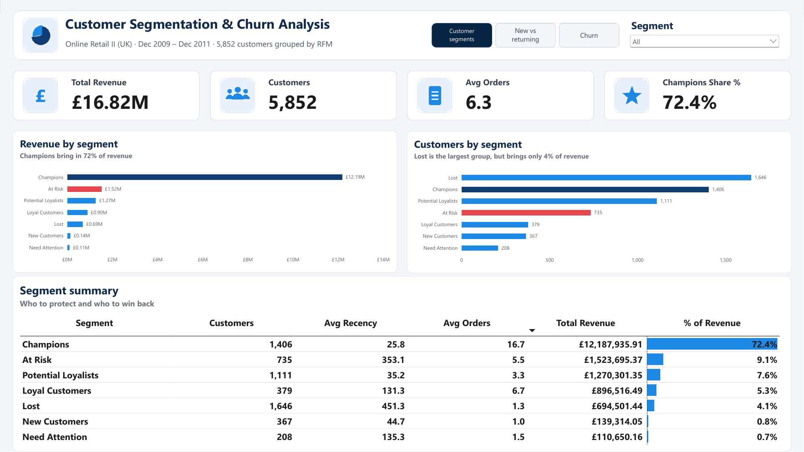
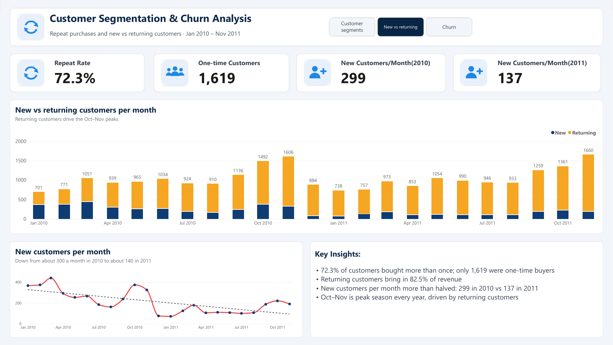
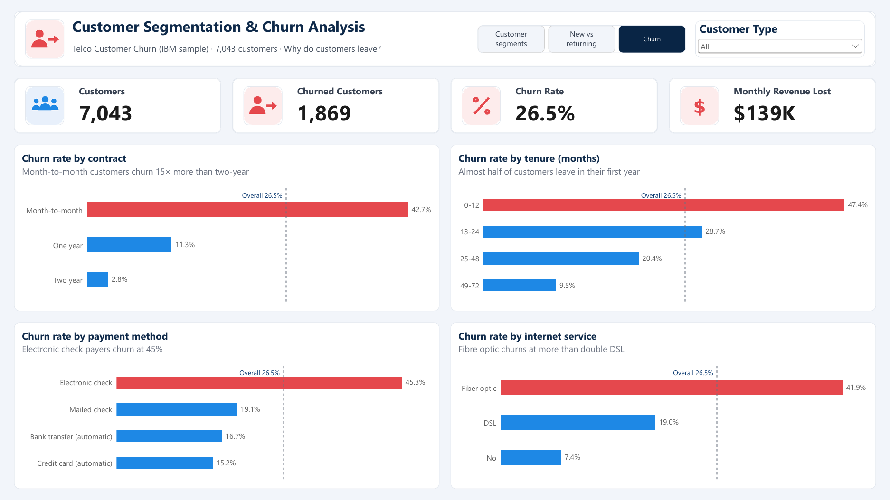
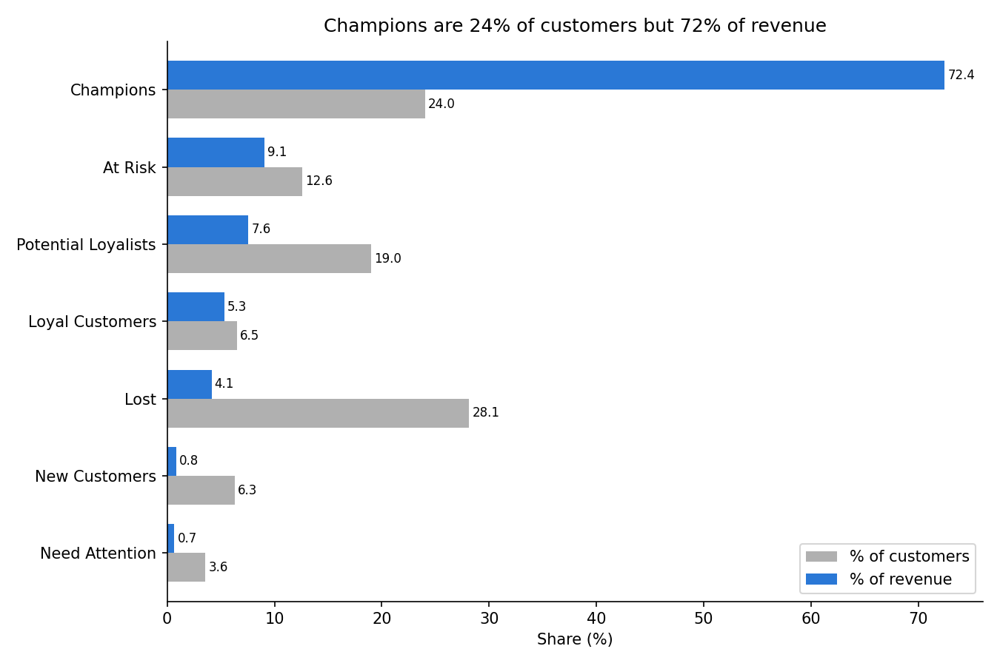
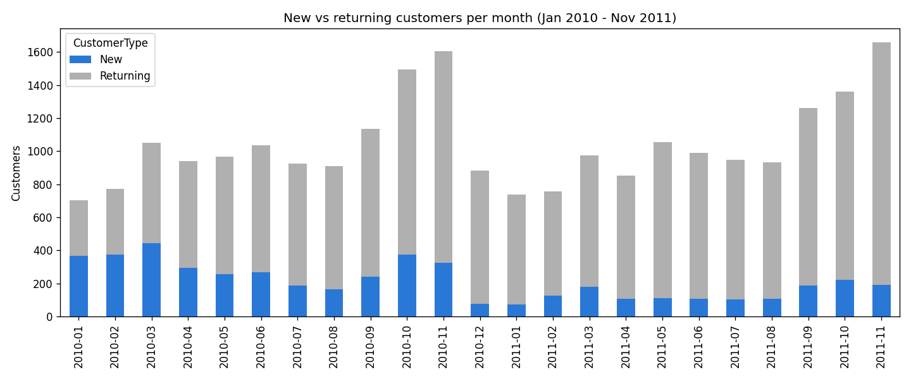
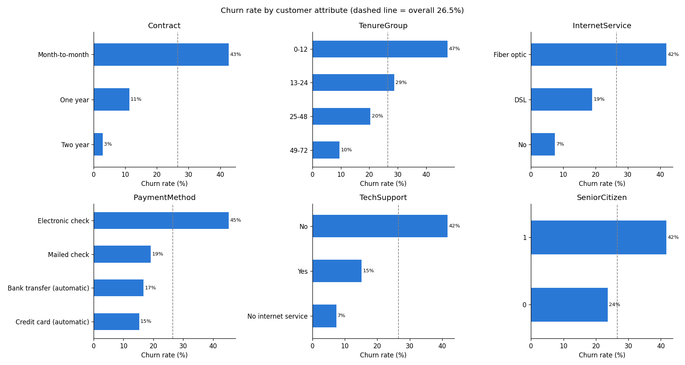

# Customer Segmentation and Churn Analysis

**Tools:** Python (pandas, matplotlib, seaborn), Jupyter, MySQL, Power BI



<details>
<summary><b>More dashboard pages: New vs returning, Churn</b></summary>





</details>

## Business problem

Two questions every customer-facing business asks:

1. **Who are our most valuable customers, and who are we losing?** Answered with RFM segmentation and repeat-purchase analysis on an online retailer's transactions.
2. **Why do customers leave?** Answered with a churn analysis of a telecom subscription company.

The two datasets come from different companies, so each question is answered on its own data.

## Datasets

| Dataset | Source | Size | Used for |
|---|---|---|---|
| Online Retail II | [UCI Machine Learning Repository](https://archive.ics.uci.edu/dataset/502/online+retail+ii) | 1,067,371 rows, Dec 2009 to Dec 2011, UK online gift retailer | RFM segments, repeat customers |
| Telco Customer Churn | [Kaggle (IBM sample data)](https://www.kaggle.com/datasets/blastchar/telco-customer-churn) | 7,043 customers, 21 columns | Churn drivers |

Raw files are not included in this repo. Download them from the links above into `1_DATA/`.

## Approach

### 1. Cleaning Online Retail II (`01_cleaning.ipynb`)

| Step | Rows left |
|---|---|
| Raw data (both sheets combined) | 1,067,371 |
| Removed exact duplicates | 1,033,036 |
| Removed cancelled invoices (start with "C") | 1,013,932 |
| Removed rows with no Customer ID | 779,495 |
| Removed zero prices | 779,425 |
| Removed non-product codes (postage, fees, tests) | 776,577 |

Two very large orders (80,995 and 74,215 units) were cancelled within minutes. Their cancellations were removed in cleaning, so the original orders were removed too. Final data: **776,575 order lines, 5,852 customers, £16.82M revenue.**

### 2. RFM segmentation (`02_rfm.ipynb`)

For each customer:

- **Recency:** days since their last purchase.
- **Frequency:** number of orders.
- **Monetary:** total spend.

Each was scored 1 to 5 using fixed, easy-to-explain ranges (for example, recency of 30 days or less = 5). Customers were then grouped into 7 segments using their recency and frequency scores.

### 3. Repeat customers (`03_repeat_customers.ipynb`)

Repeat purchase rate, and new vs returning customers each month. Each customer's first purchase month is calculated with `groupby`, then joined back onto every order line with `pd.merge(..., how="left")`, which is pandas' version of a SQL LEFT JOIN. A `pivot_table` then counts new and returning customers per month.

### 4. Churn drivers (`04_churn.ipynb`)

Churn rate by contract type, tenure, internet service, payment method, tech support and senior citizen status, plus the monthly revenue lost to churn.

### 5. SQL (`3_SQL/rfm_analysis.sql`)

The RFM segments were rebuilt in MySQL, and the results match the Python results exactly. An `INNER JOIN` then links the segments back to the transactions.

| Concept | Business question |
|---|---|
| `LOAD DATA INFILE`, row-count checks | Did all 776,575 rows load correctly? |
| `GROUP BY`, `COUNT(DISTINCT)`, `SUM`, `TIMESTAMPDIFF` | What are each customer's recency, frequency and spend? |
| `CASE` | Which score (1 to 5) and segment does each customer get? |
| `WHERE`, `ORDER BY`, `LIMIT` | Who are the top 10 At Risk customers to contact first? |
| `INNER JOIN` + conditional `SUM(CASE ...)` | How did each segment's revenue change from 2010 to 2011? |

### 6. Power BI dashboard (`4_DASHBOARD/customer_segmentation_churn.pbix`)

Three pages, linked with page-navigation buttons:

| Page | What it shows | Interactivity |
|---|---|---|
| Customer segments | Revenue, customers, average orders, Champions' share; revenue and customers by segment; segment summary table | Segment slicer |
| New vs returning | Repeat rate, one-time customers, new customers per month (2010 vs 2011); monthly new vs returning chart with a trend line | Charts cross-filter each other |
| Churn | Customers, churned customers, churn rate, monthly revenue lost; churn rate by contract, tenure, payment method and internet service, each against the overall 26.5% | Customer type slicer (Senior / Under 65) |

**DAX used:** `SUM`, `AVERAGE`, `COUNTROWS`, `DIVIDE`, `CALCULATE` with filters (for example, Champions' share of revenue and the 2010 vs 2011 monthly averages), `ALL` (for % of total), and a calculated column (`IF`) for a readable customer type.

## Key findings

### Customer segments

| Segment | Customers | % of customers | Revenue | % of revenue |
|---|---|---|---|---|
| Champions | 1,406 | 24.0% | £12.19M | 72.4% |
| At Risk | 735 | 12.6% | £1.52M | 9.1% |
| Potential Loyalists | 1,111 | 19.0% | £1.27M | 7.6% |
| Loyal Customers | 379 | 6.5% | £0.90M | 5.3% |
| Lost | 1,646 | 28.1% | £0.69M | 4.1% |
| New Customers | 367 | 6.3% | £0.14M | 0.8% |
| Need Attention | 208 | 3.6% | £0.11M | 0.7% |

- **Revenue is highly concentrated.** Champions are a quarter of customers but bring in nearly three-quarters of revenue. They bought on average 26 days ago and placed about 17 orders each.
- **At Risk customers are the biggest opportunity.** These 735 customers used to buy regularly (5.5 orders on average) but haven't bought in almost a year. They're worth £1.52M.
- **Lost is the largest group** (28% of customers) but brings only 4% of revenue.



**Segment revenue by year** (SQL `INNER JOIN` of transactions and segments):

| Segment | 2010 | 2011 | Change |
|---|---|---|---|
| Champions | £5.63M | £6.07M | +8% |
| Potential Loyalists | £0.37M | £0.88M | +138% |
| Loyal Customers | £0.53M | £0.34M | -35% |
| At Risk | £1.17M | £0.25M | **-78%** |
| Lost | £0.51M | £0.14M | -72% |
| New Customers | £0 | £0.14M | new |
| Need Attention | £0.02M | £0.09M | +444% |

- **The At Risk drop is visible in the money.** These customers spent £1.17M in 2010 but only £254K in 2011, a fall of £915K. Winning back even part of that is worth more than any other segment except Champions.

### Repeat customers



- **72.3% of customers buy more than once.** Only 1,619 of 5,852 were one-time buyers.
- **Returning customers bring in 82.5% of revenue.**
- **New customer numbers fell** from about 370 a month in early 2010 to about 100 to 200 a month in 2011. Growth now depends on existing customers.
- **October and November are the busiest months** every year (Christmas buying).

### Churn



- **Overall churn rate: 26.5%.** Customers who left were paying **$139,131 a month**, which is **30.5%** of monthly revenue.
- **Contract type matters most.** Month-to-month customers churn at 42.7%, against 11.3% on one-year and 2.8% on two-year contracts.
- **The first year is the danger zone.** 47.4% of customers in their first 12 months left, falling to 9.5% after four years.
- **Fibre optic customers churn at 41.9%**, more than double DSL (19.0%).
- **Electronic check payers churn at 45.3%**, against 15 to 19% for other payment methods.
- **Customers without tech support churn at 41.6%**, against 15.2% with it.
- **Senior citizens churn at 41.7%**, against 23.6% for other customers.
- Customers who left were paying more on average ($74.44 a month vs $61.27).

## Recommendations

1. **Win back At Risk customers** with a targeted campaign. The SQL script lists the top 10 by spend.
2. **Protect Champions** with loyalty rewards, since they drive 72% of revenue.
3. **Invest in finding new customers**, as new customer numbers have been falling.
4. **Move month-to-month customers onto longer contracts**, for example with a discount for a 12-month plan.
5. **Focus retention efforts on the first year** of a customer's life.
6. **Encourage automatic payments** over electronic checks.
7. **Review the fibre optic service** (price and quality) and promote tech support.

## Limitations

- About 23% of Online Retail II rows had no Customer ID and were excluded, so the segments cover identified customers only.
- The RFM ranges were chosen by judgement. Different ranges would move some customers between segments.
- December 2009 is the first month in the data, so every customer that month looks "new". December 2011 has only 9 days of data. Both were left out of the monthly chart.
- The churn findings show patterns, not causes. Many factors overlap: for example, most first-year customers are also on month-to-month contracts.
- The two datasets come from different companies, so the findings can't be combined.

## Repository structure

```
1_DATA/        Small output files (rfm_segments.csv, new_vs_returning_monthly.csv)
2_NOTEBOOKS/   01_cleaning, 02_rfm, 03_repeat_customers, 04_churn
3_SQL/         rfm_analysis.sql
4_DASHBOARD/   customer_segmentation_churn.pbix, dashboard.pdf, icons/, portfolio_theme.json
5_IMAGE/       Dashboard screenshots and Python charts used in this README
```

## How to reproduce

1. Download both datasets into `1_DATA/`. Rename the Telco file to `telco_churn.csv`.
2. Run the notebooks in order. Update the file paths at the top of each notebook to match your computer.
3. For the SQL check, copy `retail_rfm_input.csv` (created by `02_rfm`) into MySQL's `secure_file_priv` folder and run `3_SQL/rfm_analysis.sql`.
4. Open the `.pbix` file in Power BI Desktop.

## Author

Dheeraj | [GitHub](https://github.com/Dheeraj49)
